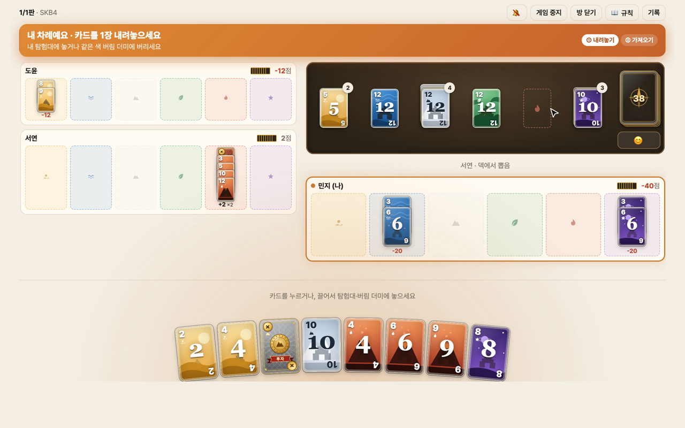
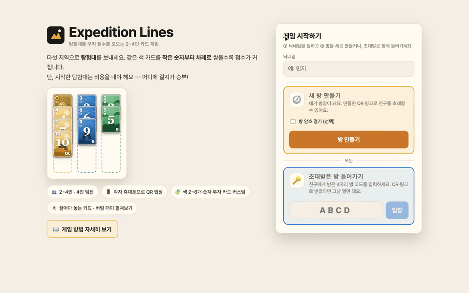
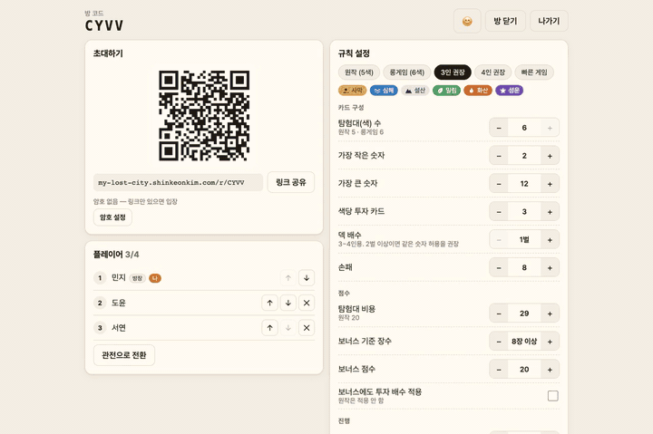
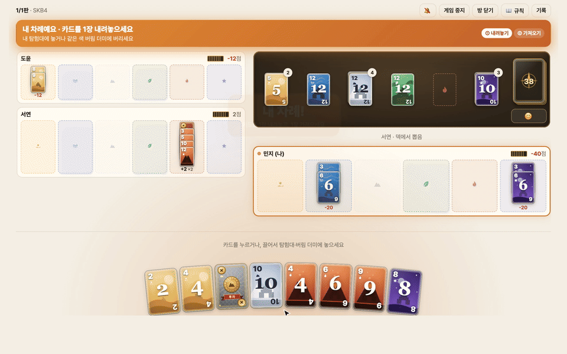
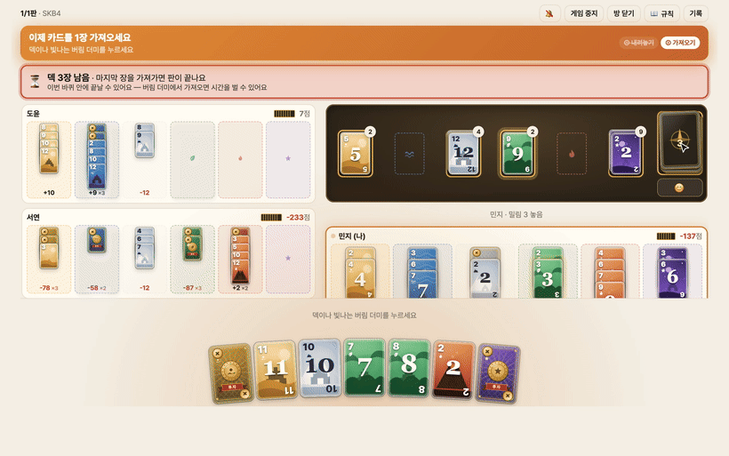
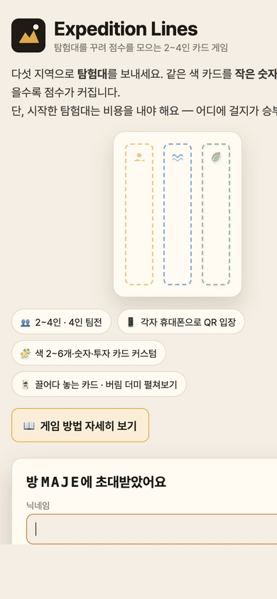

# Expedition Lines

> **보관됨** — 이 저장소는 더 이상 갱신하지 않습니다. 게임은 [shinkeonkim/boardgame](https://github.com/shinkeonkim/boardgame)의 `games/expedition-lines`로 옮겨졌고, 지금은 https://boardgame.shinkeonkim.com/games/expedition-lines 에서 플레이할 수 있어요.


탐험대(색별 열)를 쌓아 점수를 모으는 2~4인 온라인 카드 게임. 각자 휴대폰/PC로 QR·링크를 열어 바로 참가한다.
규칙 메커니즘은 고전 2인 카드 게임(조사: `docs/01-원작-룰-조사.md`)을 바탕으로 하되, 이름·일러스트·외형은 자체 제작이다.

<p align="center"></p>

**바로 플레이:** https://my-lost-city.shinkeonkim.com · 전체 데모 영상: [`docs/media/expedition-lines-demo.mp4`](docs/media/expedition-lines-demo.mp4)

## 미리보기

### 방 만들기 → QR로 초대 → 규칙 고르기

방을 만들면 4자리 코드와 QR이 생기고, 친구가 들어오면 바로 목록에 뜬다. 방장은 프리셋이나 숫자 조절로 색(2~6)과 규칙을 바꾼다.



### 끌어서 내려놓고, 덱에서 뽑기

카드를 끌어 내 탐험대나 버림 더미에 놓으면 제자리로 날아가 쌓이고, 덱에서 뽑은 카드는 뒤집히며 손으로 들어온다.
차례가 바뀌면 상단 배너와 "내 차례!" 알림이 뜨고, 덱 아래 버튼으로 감정 표현을 보낼 수 있다.



### 버림 더미 펼쳐보기

버림 더미에 마우스를 올리면 어떤 카드가 어떤 순서로 쌓였는지 펼쳐진다. 휴대폰에서는 장수 배지를 누른다.



### 판 종료와 점수표

덱이 바닥나면 색별 점수와 누적 합계가 나온다.



### 휴대폰

QR이나 링크로 열고 닉네임만 넣으면 입장한다. 카드를 눌러 고른 뒤 "탐험대에 놓기", 덱을 눌러 뽑는다.



> 영상과 GIF는 `npm run build && npm run media`로 실제 앱을 봇과 함께 돌려 녹화한 것이다 (`scripts/media/record.mjs`).

## 기능

- 방 만들기 → 4자리 코드 + QR/공유 링크, 선택적 방 암호(QR에 암호 포함 토글)
- 2~4인 + 관전, 끊겨도 같은 기기에서 다시 열면 자동 복귀, 방장 자동 승계
- 방장이 게임 중지 → 로비에서 규칙을 바꾼 뒤 이어서 하기(설정이 같으면 하던 판 그대로, 바뀌면 끝난 판 점수를 이어 새 판)
- 규칙 커스텀: 색 2~6, 숫자 범위, 색당 투자 카드, 덱 배수, 손패, 탐험대 비용(자동 보정), 보너스 기준/점수/배수, 판 수,
  턴 타이머(초과 시 자동 진행), 같은 숫자 허용, 방금 버린 카드 재획득 금지, 덱 장수 공개, 점수 미리보기, 버림 더미 펼쳐보기, 4인 2:2 팀전
- 매 판 첫 차례는 무작위(서버 crypto 난수)로 정하고 시작할 때 화면에 알림 (원작의 "고득점자가 다음 판 선" 대신)
- 프리셋: 원작 / 롱게임(6색) / 3인 권장 / 4인 권장 / 빠른 게임, 로비에서 "1인당 예상 턴 수" 표시
- 카드 일러스트(숫자가 클수록 목적지 유적이 가까워짐), 카드 날아가기/덱에서 뒤집으며 뽑기/나눠주기 애니메이션,
  버림 더미 호버(모바일은 장수 배지 탭) 시 쌓인 카드가 펼쳐짐, 드래그로 내려놓기/버리기

## 개발

```bash
npm install
npm run dev        # 서버 :3001 + Vite :5173 (휴대폰은 같은 Wi-Fi에서 로비의 QR로 접속)
npm test           # 엔진·방 로직 테스트
npm run build && npm start   # 프로덕션 빌드 → :3001 (PORT로 변경)
npm run media      # README용 영상/GIF 다시 녹화 (빌드 후, ffmpeg + Playwright 크로미움 필요) → docs/media/
```

구조: `packages/engine`(순수 게임 로직), `apps/server`(Node + Socket.IO, 권위 서버, 방 상태는 메모리),
`apps/web`(React + Vite).

## 배포 (oh-my-homelab)

- `main` push → `.github/workflows/release.yml`이 `ghcr.io/shinkeonkim/my-lost-city:sha-xxxx` 빌드 후 `deploy/kustomization.yaml` 태그 갱신
- oh-my-homelab의 `helm-charts/apps/my-lost-city.yaml`이 `deploy/`를 ArgoCD로 동기화
- 방 상태가 메모리에 있으므로 replicas 1. **무중단 배포**: RollingUpdate로 새 파드를 먼저 띄우고, 새 파드가
  내부 Service `my-lost-city-handoff`(:9090, Ready인 이전 파드만 가리킴)에서 방 상태를 받아온 뒤 Ready가 된다.
  이전 파드는 넘겨준 순간 Ready를 내려놓고 진행 요청을 잠깐(1~2초) 거절하며, SIGTERM에 연결을 끊어 클라이언트가 토큰으로
  새 파드에 자동 재접속한다 → 진행 중인 게임이 그대로 이어진다. (파드 간 9090은 oh-my-homelab 네트워크 정책에서 허용)
- 노드 장애처럼 이전 파드 없이 새로 뜨는 경우에는 빈 상태로 시작한다.
- 환경변수 `PUBLIC_URL`: QR/공유 링크에 쓰는 외부 주소
